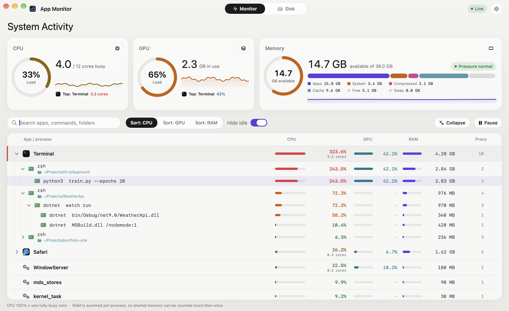
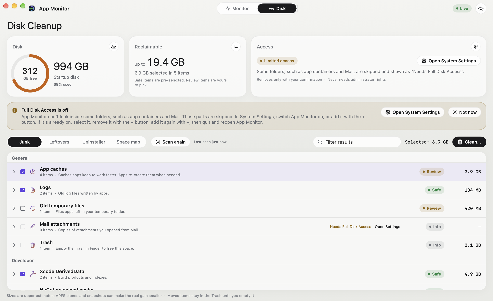
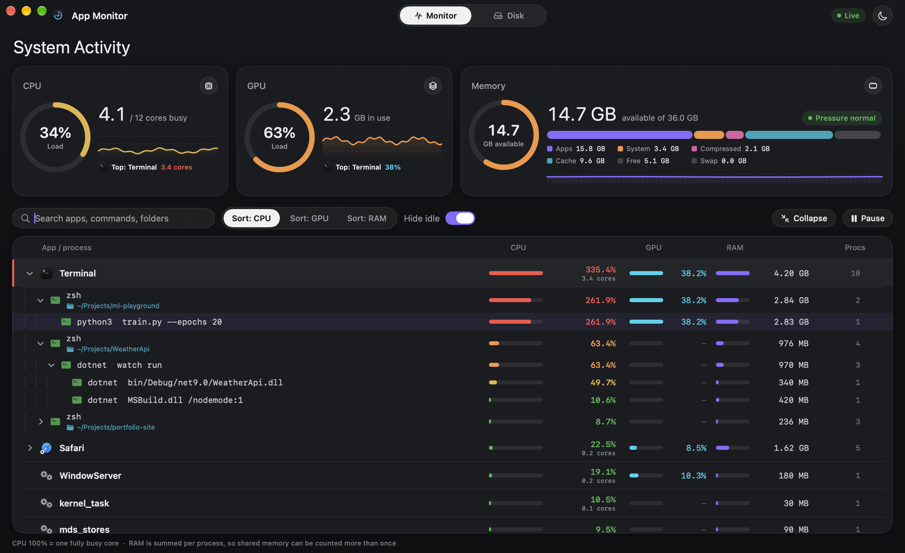
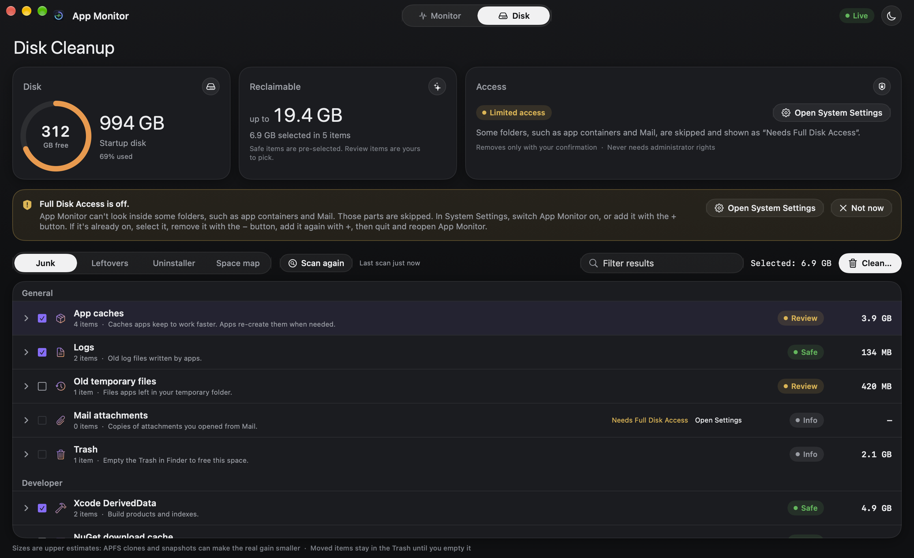

<p align="center">
  
</p>

<h1 align="center">App Monitor</h1>

<p align="center">
  A clear, free process monitor and disk cleaner for macOS. It shows what each app <i>really</i>
  costs, including every process it started, and finds caches, leftovers and junk you can safely
  remove.
</p>





<details>
<summary>Dark theme</summary>





</details>

The app has a light and a dark theme. It follows macOS by default; pick System, Light or Dark with the
round button at the top right, or in Settings.

<sub>The screenshots use demo mode: every process, folder and number in them is made up.</sub>

## Why

Activity Monitor shows each process on its own row. An app that starts helpers, terminals or
scripts looks idle while its child processes heat up your Mac. Its memory numbers also make it
hard to tell how much RAM you actually have left.

App Monitor groups everything under the app that started it, adds the numbers up, and explains
memory in plain terms.

## Features

- **Per-app totals.** CPU, GPU and RAM for each app, including all its child processes.
- **Process tree.** Expand an app to see what it started, all the way down to the script doing
  the work. Shell processes show their command line and working folder.
- **Show hottest.** One click opens the busiest branch.
- **CPU panel.** Overall load, "N of M cores busy", a 3-minute graph, and the busiest app.
- **GPU panel.** Overall GPU load, GPU memory in use, a graph, and per-app GPU use.
- **Memory panel.** How much RAM is *really* available, split into Apps, System, Compressed,
  Cache and Free, plus memory pressure and swap. Hover over any part for an explanation.
- **End or force-quit** a process, a process with all its children, or a whole app, always
  after a confirmation.
- Search, sort by CPU / GPU / RAM, hide idle child processes, pause.
- **Disk cleaner** (Disk tab). Finds app caches, old logs and crash reports, old temporary files,
  Mail attachment copies and developer caches (Xcode, Unity, NuGet, npm, pnpm, Yarn, pip,
  Homebrew, Docker). Every item says why it was found. Only items marked *Safe* are pre-selected,
  files go to the Trash through Finder, so Finder's **Put Back** restores them, and tool caches are cleared with the tool's own
  command, shown to you before it runs. Age limits are adjustable in Settings (⌘,).
- **Space map** (Disk tab → Space map). Shows which folders in your home folder and Applications
  take the most space, largest first, labelled with the app they belong to. Large folders
  unchanged for six months are highlighted. Everything can be revealed in Finder. Items you pick
  one at a time can go to the Trash after a confirmation; everything in `~/Library`, apps, photo
  libraries, hidden folders and synced folders stay Reveal only.
- **Leftovers** (Disk tab → Leftovers). Finds data left behind by apps you deleted by dragging
  them to the Trash: settings, caches, app data, web data and logs, grouped per app. An item is
  listed only if no check finds its app on this Mac (installed apps and their helpers, apps
  LaunchServices or Spotlight know, launch jobs, plug-ins, running apps) and nothing of that app
  changed for 30 days. Nothing is pre-selected; uncertain matches are kept apart under
  "Possible leftovers". App containers are checked only with Full Disk Access.
- **Uninstaller** (Disk tab → Uninstaller). Pick an app from Applications, or drop one onto the
  Disk tab, to see the app and every file that belongs to it: caches, logs, settings, app data,
  containers and launch agents, matched by its bundle IDs. Another app's files are never listed,
  and data an app shares with another app is shown but kept. The app, its caches and its settings
  are pre-selected; everything goes to the Trash, so Put Back works. Apps that come with macOS,
  apps outside Applications and running apps are not removed.
- Samples only while its window is on screen. Sampling every 2 seconds uses about 10% of one CPU
  core (measured on an M4 Pro with about 1,100 processes); with the window closed, hidden,
  minimised or covered it uses almost none.
- Native SwiftUI, no dependencies, universal (Apple Silicon and Intel).

## Install

### Build from source (recommended)

You need macOS 14 Sonoma or later and the Xcode Command Line Tools (`xcode-select --install`).
Full Xcode isn't needed.

```bash
git clone https://github.com/laimis91/mac-app-process-monitor.git
cd mac-app-process-monitor
./AppMonitor/build.sh
open "AppMonitor/App Monitor.app"
```

Drag `App Monitor.app` into Applications to keep it.

A plain build is ad-hoc signed, so macOS treats every rebuild as a new app and forgets Full Disk
Access. To keep it, sign with your own certificate (see [Signing](#signing)):

```bash
APPMON_SIGN_IDENTITY="App Monitor Signing" ./AppMonitor/build.sh
```

### Downloaded build

Builds from the [Releases page](https://github.com/laimis91/mac-app-process-monitor/releases)
are signed with the project's own certificate but not notarized by Apple, so macOS blocks them
the first time. Before you open it, [verify your download](#verify-your-download). Then open the
app once, go to **System Settings → Privacy & Security** and click **Open Anyway**.

### Verify your download

Because macOS can't vouch for a self-signed app, check it yourself before clicking **Open
Anyway**. Unzip the download and run:

```bash
codesign --verify --strict "App Monitor.app" && codesign -d -r- "App Monitor.app"
```

The requirement must name both the app and the project's certificate, exactly:

```
designated => identifier "io.github.laimis91.appmonitor" and certificate leaf = H"97a38ab68479a7bc0f6dd1d3c7fdf5077d7454c4"
```

A different certificate hash, or `cdhash` instead of `identifier … and certificate leaf`, means
the app wasn't signed by this project: don't open it. Also compare `shasum -a 256` of the zip
with the SHA-256 in the release notes, and check that the zip was built from this repository by
its release workflow:

```bash
gh attestation verify AppMonitor-<version>.zip --repo laimis91/mac-app-process-monitor
```

## Reading the numbers

| Value | Meaning |
|---|---|
| **CPU %** (per app or process) | 100% = one fully busy CPU core. 250% means about 2.5 cores. Same convention as `ps`, `top` and Activity Monitor. |
| **LOAD %** (CPU panel) | Share of the whole Mac: all cores together = 100%. |
| **GPU %** | Share of GPU time the app used over the last refresh (2 seconds). |
| **RAM** | Resident memory, summed per process. Memory shared between processes can be counted more than once, so app totals can read a little high. |
| **Available** (memory panel) | Total RAM minus Apps, System and Compressed. Cache counts as available, because macOS frees it the moment an app needs it. |
| **Pressure** | The best single sign of whether you need more RAM. Green is fine, whatever the other numbers say. |

## Privacy

App Monitor runs entirely on your Mac. It has no network code and collects nothing. The only
things it saves are the disk cleaner's settings and ignore list, in the app's preferences; scan
results are never stored. It reads the same information as Activity Monitor: the process list
from `ps`, memory statistics from the kernel, and GPU statistics from IOKit.

### Moving items to the Trash

The disk cleaner asks Finder to move items to the Trash, so you can restore any of them with
**Put Back**. The first time you clean, macOS asks whether App Monitor may control Finder. If
you decline, items are still moved to the Trash, but without Put Back (drag them back instead).
You can change this in **System Settings → Privacy & Security → Automation**.

### Full Disk Access

The disk cleaner works without it, but skips folders macOS protects (app containers, Mail, the
Trash) and marks them "Needs Full Disk Access". To include them, switch App Monitor on in
**System Settings → Privacy & Security → Full Disk Access**. Releases after 1.1.0 are all signed
with the same certificate, so macOS should keep this permission when you update.

If App Monitor is switched on there but the Disk tab still says Full Disk Access is off, macOS
is holding a permission for an older signature of the app. Switching it off and on doesn't
replace that. Select App Monitor in the list, remove it with the **−** button, add it again
with **+** (from Applications), then quit and reopen App Monitor. This is needed once when
updating from 1.1.0 or earlier (ad-hoc signed), and after every rebuild if you run ad-hoc builds
of your own.

## Demo mode and screenshots

Demo mode replaces real processes with made-up ones, which is handy for screenshots:

```bash
open -n "AppMonitor/App Monitor.app" --env APPMON_DEMO=1
```

`scripts/screenshot.sh` rebuilds the app and regenerates the light and dark screenshots in `docs/`
from demo mode. In a debug build, `--env APPMON_APPEARANCE=light` (or `dark`) forces a theme.

## Also included

`scripts/apptop.py` is a small terminal version: per-app CPU and RAM including child
processes, refreshed every 2 seconds.

```bash
python3 scripts/apptop.py              # live view
python3 scripts/apptop.py --detail Safari
```

## Project layout

```
AppMonitor/
  main.swift        data collection: processes, memory, GPU
  ProcessTree.swift which app owns each process; pid identity checks before ending one
  Theme.swift       light and dark colours, appearance setting, pill controls
  Views.swift       Monitor tab UI and the window
  Demo.swift        demo mode and window capture
  CleanerModel.swift, CleanerViews.swift   Disk tab and Settings window
  SpaceMapModel.swift, SpaceMapViews.swift Space map view
  Cleaner/          disk cleaner engine: rules, path guard, scanner, actions
  Icon/             app icon and the script that draws it
  build.sh          builds App Monitor.app
  AppMonitor.entitlements  its only entitlement: Apple events to Finder (hardened runtime)
scripts/            apptop.py, screenshot.sh, selftest.sh, grouping-test.sh, fixture-test.sh,
                    make-fixtures.sh (the fake folder trees fixture-test.sh uses), make-signing-cert.sh
docs/               README screenshots, disk cleaner specification
```

## Tests

```bash
scripts/selftest.sh       # disk cleaner logic: path guards, rules, key parsing, settings, Space map
scripts/grouping-test.sh  # which app owns each process, in any visit order; pid identity checks
scripts/fixture-test.sh   # scans and cleans a made-up folder tree (its tiny fake files go to your Trash)
```

## Releases

Pushing a version tag builds the app on GitHub Actions and publishes it on the Releases page
([`.github/workflows/release.yml`](.github/workflows/release.yml)). The workflow checks that the
tagged commit is on `main` and that the signing secrets are there, runs the self-test, builds a
signed universal app with the tag's version, checks the signature, hardened runtime and
entitlements, and uploads `AppMonitor-<version>.zip` with its SHA-256 in the release notes and a
build provenance attestation. If the tag isn't on `main` or the signing secrets are missing it
fails before building and publishes nothing.

```bash
git tag v1.2.3
git push origin v1.2.3
```

Local builds use version 1.2.3 unless `APPMON_VERSION` is set.

## Signing

macOS remembers Full Disk Access by the app's *designated requirement*. An ad-hoc signature's
requirement is a hash of that one build (`designated => cdhash H"…"`), so every update looks
like a new app. A build signed with a certificate has a requirement that names the bundle ID and
the certificate (`designated => identifier "io.github.laimis91.appmonitor" and certificate
leaf = H"…"`), which stays the same as long as the same certificate signs every release.

Every build, signed or ad-hoc, uses the **hardened runtime** (`codesign --options runtime`), so
no other process can load code into App Monitor, for example with `DYLD_INSERT_LIBRARIES`, and
use its Full Disk Access. Its only entitlement,
[`AppMonitor/AppMonitor.entitlements`](AppMonitor/AppMonitor.entitlements), is
`com.apple.security.automation.apple-events`: App Monitor asks Finder to move items to the
Trash, so Put Back works.

`build.sh` reads these variables:

| Variable | Effect |
|---|---|
| `APPMON_SIGN_IDENTITY` | Sign with this keychain identity (name or SHA-1). Unset: ad-hoc. The build fails if the result has no identifier-and-certificate requirement. |
| `APPMON_SIGN_KEYCHAIN` | Look for the identity only in this keychain, such as the dedicated signing keychain below. |
| `APPMON_RELEASE=1` | Refuse to build without `APPMON_SIGN_IDENTITY`. The release workflow sets it. |

Every build fails unless the signature has the hardened runtime flag and the Apple events
entitlement. Check a build with `codesign -d -r- "AppMonitor/App Monitor.app"` (requirement),
`codesign -dv "AppMonitor/App Monitor.app"` (`flags=0x10000(runtime)`) and
`codesign -d --entitlements - "AppMonitor/App Monitor.app"`.

### Create the certificate (maintainer, once)

The release certificate is a self-signed code-signing certificate named "App Monitor Signing".
It lives in the maintainer's keychain and in GitHub secrets, never in the repo. Create it once
and keep it: a new certificate makes every user grant Full Disk Access again.

Keep it in a **dedicated keychain** that locks on sleep and after 5 minutes, not in the login
keychain. The login keychain stays unlocked while you're logged in, and the key is imported so
that `codesign` can use it without asking, so any program running as you could sign something
as App Monitor. In a locked keychain it can't.

```bash
K=~/Library/Keychains/appmon-signing.keychain-db
D=$(mktemp -d)      # private temporary folder, not synced to iCloud
scripts/make-signing-cert.sh --keychain "$K" --p12 "$D/appmon.p12"
```

The script creates the keychain if it doesn't exist (`security` asks for a new password for
it; use a different one from your login password) and sets it to lock on sleep and after 5
minutes (`security set-keychain-settings -l -u -t 300`). It makes the certificate and key in a
private temporary folder, adds them to the keychain, and exports them to the `.p12` (it asks
for a `.p12` password, at least 12 characters, without echoing it; it refuses to write it
inside any git checkout or under `~/Desktop`, `~/Documents`, `~/Library/Mobile Documents` or
`~/Library/CloudStorage`, which may sync to the cloud). Put the `.p12` in GitHub secrets (below),
then `rm -rf "$D"`.

To sign, unlock the keychain first; it locks itself again after 5 minutes without use:

```bash
security unlock-keychain "$K"
APPMON_SIGN_KEYCHAIN="$K" APPMON_SIGN_IDENTITY="App Monitor Signing" ./AppMonitor/build.sh
```

The first signed build may ask whether `codesign` can use the key: click **Always Allow**.
`security find-identity -p codesigning` lists it as `CSSMERR_TP_NOT_TRUSTED`; that is expected
for a self-signed certificate and doesn't stop `codesign`.

Without `--keychain` (and without `APPMON_SIGN_KEYCHAIN`) the script uses the login keychain.
Contributors who build from source can make their own certificate either way (without
`--p12`), or stay ad-hoc.

### Move the certificate out of the login keychain (maintainer, once)

If "App Monitor Signing" is already in your login keychain, move it, keeping the same
certificate (a new one makes every user grant Full Disk Access again):

1. Create the dedicated keychain:

   ```bash
   K=~/Library/Keychains/appmon-signing.keychain-db
   security create-keychain "$K"                    # asks for a new password
   security set-keychain-settings -l -u -t 300 "$K" # lock on sleep and after 5 minutes
   D=$(mktemp -d); open "$D"                        # private temporary folder
   ```

2. Export it from the login keychain: in Keychain Access, **login → My Certificates → App
   Monitor Signing → File → Export Items…**, format **Personal Information Exchange (.p12)**,
   save it as `appmon.p12` in the folder that just opened, and give it a password.
3. Import it into the dedicated keychain and check both copies have the same SHA-1:

   ```bash
   security import "$D/appmon.p12" -k "$K" -f pkcs12 -T /usr/bin/codesign   # asks for the .p12 password
   security find-identity -p codesigning "$K"
   security find-identity -p codesigning ~/Library/Keychains/login.keychain-db
   ```

4. Sign a test build with `APPMON_SIGN_KEYCHAIN="$K"` (above) and check that
   `codesign -d -r- "AppMonitor/App Monitor.app"` shows the same `certificate leaf` as before.
5. Delete it from the login keychain, then the `.p12`:

   ```bash
   security delete-identity -Z <SHA-1 from step 3> ~/Library/Keychains/login.keychain-db
   rm -rf "$D"
   ```

   Or delete both the certificate and its private key in Keychain Access (**login → My
   Certificates → App Monitor Signing → Delete**).

### GitHub secrets and the release environment (maintainer, once)

The release workflow runs in a GitHub **environment** called `release` and needs two secrets
there:

| Secret | Value |
|---|---|
| `APPMON_SIGN_P12` | The `.p12`, base64-encoded |
| `APPMON_SIGN_P12_PASSWORD` | The `.p12` password |

```bash
base64 -i "$D/appmon.p12" | gh secret set APPMON_SIGN_P12 --env release
gh secret set APPMON_SIGN_P12_PASSWORD --env release
rm -rf "$D"
```

`gh secret set` without a value asks for it without echoing. The workflow imports the `.p12`
into a temporary keychain with a random password, signs, and deletes the keychain at the end of
the job. If the job can't see the secrets it fails with an error that says so and publishes
nothing.

Set the environment and tags up in the repository settings (these can't be done from the
workflow):

1. **Settings → Environments → New environment**, name `release`.
   - **Deployment branches and tags → Selected branches and tags → Add rule**, type **Tag**,
     pattern `v*.*.*`. Only version tags can then use its secrets.
   - **Environment secrets → Add environment secret**: `APPMON_SIGN_P12` and
     `APPMON_SIGN_P12_PASSWORD` (or the `gh secret set --env release` commands above). Use the
     same `.p12` as before; if you no longer have it, export it again from the dedicated keychain
     in Keychain Access into a `mktemp -d` folder.
   - Optionally **Required reviewers**: yourself, so every release waits for your approval.
2. **Settings → Secrets and variables → Actions → Repository secrets**: delete
   `APPMON_SIGN_P12` and `APPMON_SIGN_P12_PASSWORD`, so only the `release` environment has them.
3. **Settings → Rules → Rulesets → New ruleset → New tag ruleset**, name `release tags`,
   enforcement **Active**, target **Include by pattern** `v*.*.*`, rules **Restrict creations**,
   **Restrict updates** and **Restrict deletions**, with yourself (or the admin role) in the
   bypass list. Then only you can push a release tag.

The workflow also refuses a tag whose commit isn't on `main`
(`git merge-base --is-ancestor`), so a tag on an unmerged branch never publishes a signed build.

## License

[MIT](LICENSE)
